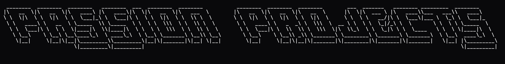

  
  

A collection of my personal engineering and research projects exploring ideas in:

- algorithms
- robotics
- haptics
- control systems
- embedded systems
- hardware design
- computer vision
- scientific computing

Most of these projects were developed as **independent experiments, course extensions, or research explorations**.

~~~~~~~~~~~~~~~~~~~~~~~~~~~~~~~~~~~~~~~~~~~~~~~~~~~~~~~~~~~~~~~~~~~~~~~~~~~~~~~~~~~~~~~~~~~~~~~~~~~~~~~~~~~~~~~~~~
> Projects are listed in **reverse chronological order (newest first)**.

---

# Projects

### (~\_~) SAT Fusion — Sensor Fusion with SAT Solvers
A lightweight **SAT-based decision engine** for embedded sensor fusion.

The system integrates:
- IMU for tumbling detection
- Ultrasonic sensing for obstacle detection
- Dual IR sensors for path following

A **servo-based haptic feedback system** communicates navigation decisions to the user.  
Designed as a prototype assistive navigation system for **visually impaired mobility**.

---

### [::] Particle Swarm Optimization — Car Simulation
A simulation framework exploring **Particle Swarm Optimization ($\text{PSO}$)** applied to vehicle control and trajectory optimization.

Focus areas:
- Swarm intelligence
- Distributed optimization
- Nonlinear control behavior

---

### $\langle * \rangle$ Dummy QPU vs CPU Factorization Benchmark
A classical multithreaded benchmark comparing **$\text{CPU}$-based factorization** with **quantum-inspired computational models**.

Designed as a conceptual exploration of:
- $\text{QPU}$-style computation
- Hybrid classical architectures
- Multithreaded performance scaling

---

### $\bigtriangleup$ RRT Visualization and Implementation
Implementation and visualization of **Rapidly-exploring Random Trees ($\text{RRT}$)**.

Applications:
- Robotic motion planning
- High-dimensional search spaces
- Autonomous navigation

Includes graphical visualization of the search tree expansion.

---

### $[ \parallel \parallel \parallel ]$ RISC-V Architecture in Verilog
Implementation of a simplified **$\text{RISC-V}$ processor architecture** in Verilog.

Focus areas:
- Instruction decoding
- Pipeline design
- Hardware logic implementation

---

### $[\quad][\quad]$ 2D Convolution Engine in Verilog
A hardware implementation of **$2\text{D}$ convolution operations** commonly used in image processing.

Applications:
- $\text{FPGA}$ image filtering
- Convolution acceleration
- Computer vision preprocessing

---

### (o-o) Simple QPU Instruction Emulator
A conceptual emulator for **quantum-inspired instruction sets** running on classical hardware.

Explores:
- Hybrid instruction models
- Alternative computational abstractions

---

### $\gg\gg$ FFT Verilog Architecture
Hardware implementation of a **Fast Fourier Transform ($\text{FFT}$)** architecture.

Includes benchmarking against:
- $\text{MATLAB}$ $\text{FFT}$ implementations
- Numerical accuracy comparisons

---

### $[=^\wedge=]$ Lane Following Simulation — Kalman Filter Passivity Control
Simulation of autonomous lane tracking using:
- Kalman filtering
- Passivity-based control techniques

Designed as a control systems exploration for **autonomous vehicle navigation**.

---

### $\bigtriangleup$ Borůvka-Based Feature Extraction
Experimental computer vision method inspired by **Borůvka’s algorithm**.

Focus areas:
- Graph-based feature extraction
- Parallelizable image segmentation
- Algorithmic vision pipelines

---

### [0\_0] Autonomous Maze Solver Robot
A **$1:10$ scale three-wheeled robot** capable of solving acyclic mazes.

Key ideas:
- Quantum-inspired wall-following logic
- Autonomous path exploration
- Embedded robotics control

---

### $\langle * \rangle$ Quantum Graph Baseline
Experimental framework exploring **graph structures inspired by quantum computation models**.

---

### [+++] Multithreaded Matrix Multiplication and Compression
Parallel matrix multiplication experiments combined with compression techniques to explore:
- High-performance computing
- Algorithmic optimization
- Memory-efficient linear algebra

---

### (•‿•) Particle Physics Neural Networks
Application of neural networks to **particle physics simulations** using:
- $\text{PYTHIA}$
- $\text{ROOT}$
- $\text{TensorFlow}$

Inspired by workflows used in **$\text{CERN}$ research environments**.

---

### $[\text{CNN}]$ Custom Educational Convolutional Neural Network
A **from-scratch $\text{CNN}$ implementation** designed for educational understanding of deep learning mechanics.

---

### $\mid\Longrightarrow$ Telescope Balance Controller
A feedback controller for **stabilizing telescope orientation** during observation.

---

### ☾ Real-Time Moon Positioning for Telescope Tracking
Astronomical computation module that determines **real-time lunar position** to guide telescope tracking.

---

### $[\text{WEB}]$ Personal Portfolio Website
A personal portfolio website showcasing projects, experiments, and research explorations.

---

### $[\text{MC}]$ Monte Carlo Approach to the Specker Game
Course project developed at **ECE NTUA** exploring probabilistic strategies using Monte Carlo simulations.

---

# Future Areas of Exploration

Across new projects I would like to explore topics including:
- Robotics and autonomous systems
- Embedded systems
- Hardware design ($\text{Verilog}$ / $\text{FPGA}$ concepts)
- Optimization algorithms
- Quantum-inspired computing

---

*More experiments and research prototypes will be added over time.*
